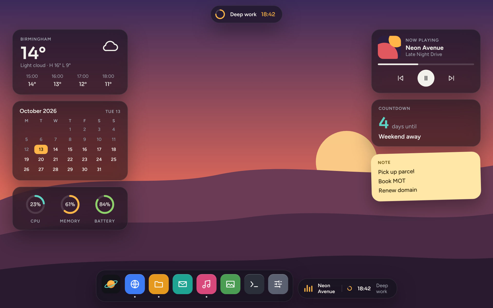
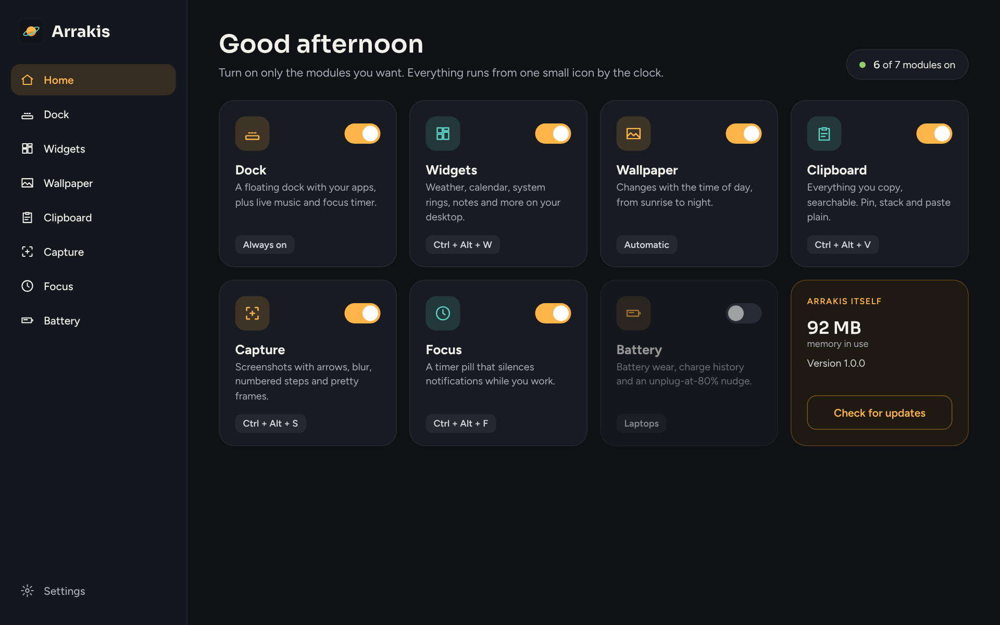
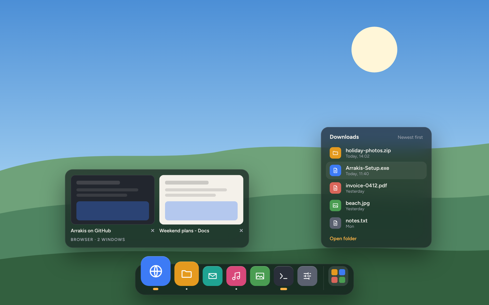
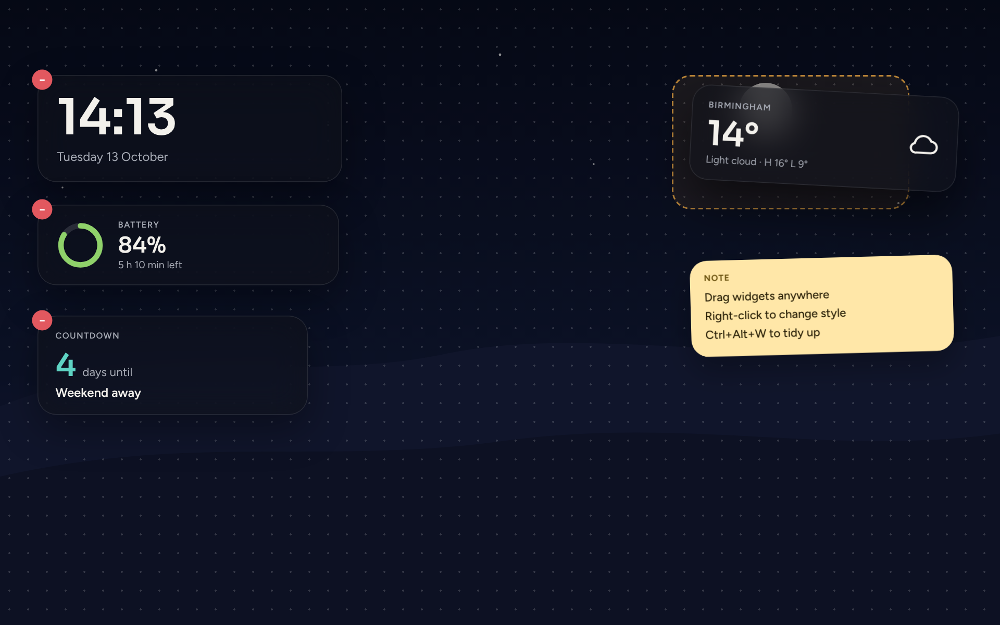
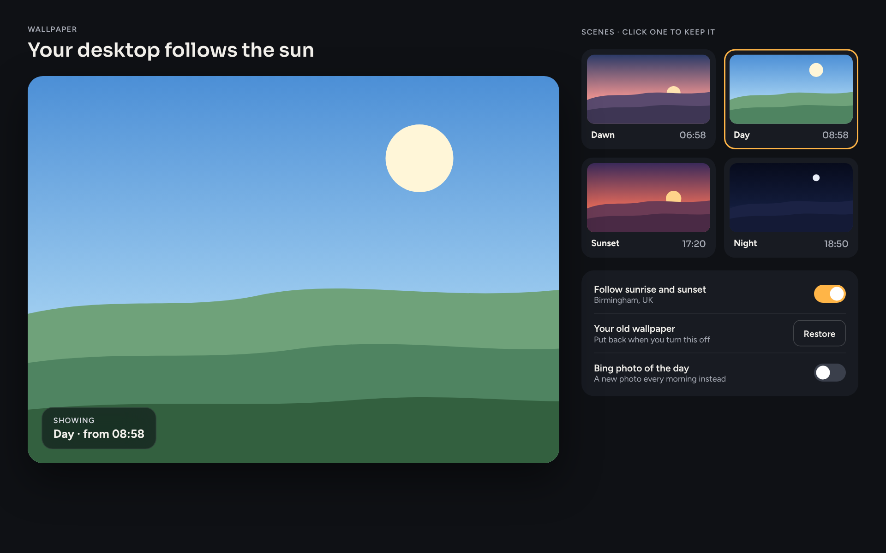
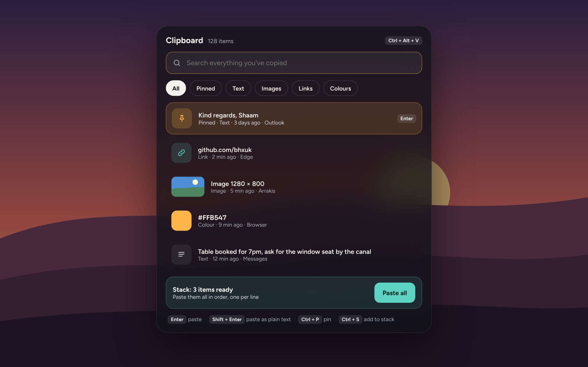
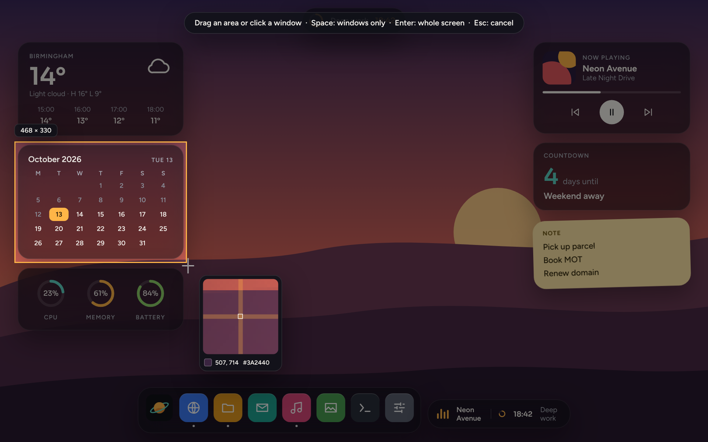
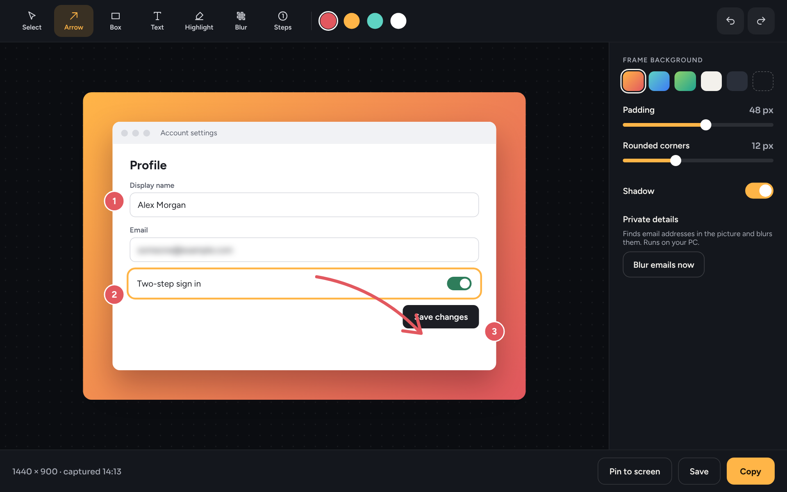
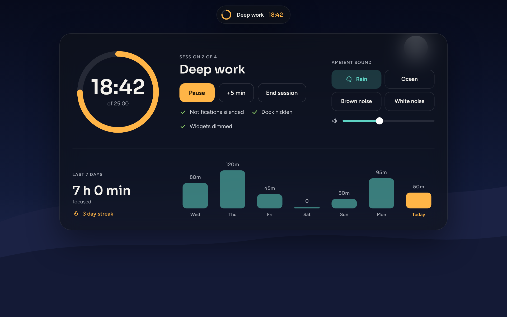
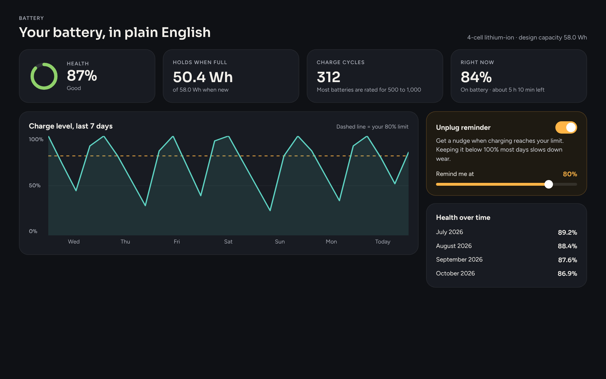

<div align="center">


# Arrakis

**Your whole desktop, in one small app.**

A dock, desktop widgets, a wallpaper that follows the sun, a proper clipboard history,
a screenshot editor, a focus timer and battery health, for Windows 10 and 11.
Turn on only the parts you want.

**[Download Arrakis for Windows](https://github.com/bhxuk/arrakis/releases/latest/download/Arrakis-Setup.exe)**  ·  [Website](https://bhxuk.github.io/arrakis/)  ·  [User guide](docs/USER-GUIDE.md)  ·  [What's new](CHANGELOG.md)



</div>

---

## What's inside

Arrakis is one app with seven modules. Each one has its own switch, so it only does what you ask it to.

| Module | What it does | Shortcut |
|---|---|---|
| **Dock** | A floating dock for your apps, with what's playing and your focus timer alongside. Can replace the taskbar. | Always on |
| **Widgets** | Clock, weather, calendar, system rings, battery, now playing, notes and countdowns on your desktop. | Ctrl+Alt+W |
| **Wallpaper** | Dawn, day, sunset and night scenes that change with real sunrise and sunset times. Or Bing's photo of the day. | Automatic |
| **Clipboard** | Everything you copy, searchable. Pin things, stack several copies and paste them together, paste as plain text. | Ctrl+Alt+V |
| **Capture** | A full screenshot tool: area, window, full screen, all screens or delayed. Edit with 14 tools, effects and frames, then copy, save, print or pin. | Ctrl+Alt+S |
| **Focus** | A timer pill at the top of the screen that silences notifications, plays rain or ocean sounds and tracks your week. | Ctrl+Alt+F |
| **Battery** | Battery wear, charge history and a nudge to unplug at 80%. For laptops. | Laptops |

## A quick tour

### The hub

Every module in one window, each with its own switch. Click a card for its settings.



### Dock

Your pinned apps and everything that's open, with a running dot under each. Icons magnify as you move across them.
Click to switch, click again to minimise, right-click to pin or close. What's playing and your focus timer sit
next to it. Pick from three styles, and hide the Windows taskbar if you want the dock to replace it.



### Widgets

Drag them anywhere. They stay behind your windows like part of the wallpaper. Right-click for style and options,
or press **Ctrl+Alt+W** to show remove buttons.



### Wallpaper

Four scenes drawn at your screen's exact resolution. Arrakis works out sunrise and sunset for your city each day and
switches between them. Your original wallpaper comes back when you turn it off.



### Clipboard

Press **Ctrl+Alt+V** wherever you are. Type to search, Enter to paste, Shift+Enter for plain text.
Links, colours and images are recognised. Password managers that mark copies as private are never recorded.



### Capture

A complete screenshot studio, built in.

**Capture** an area (**Ctrl+Alt+S**), a window (**Ctrl+Alt+D**), the full screen (**Ctrl+Alt+A**), every screen at once,
the same area as last time, or after a 5-second countdown. While you pick, a magnifier shows the exact pixel and its colour,
windows light up as you hover them, and **Space** switches between area and window mode. You can also set it up to use
the Print Screen key, with Alt, Ctrl and Shift for the other modes.



**Edit** with 14 tools: select and move, box, ellipse, line, arrow, freehand pen, text, speech-bubble callouts, numbered steps,
highlighter, pixelate, blur, crop and a colour picker. Everything can be recoloured, moved, deleted and undone.
Then rotate, flip, resize, greyscale, invert, add a border, a drop shadow or torn edges, and put it on a frame.
**Copy text** reads the words in a screenshot, and email addresses are blurred for you, all on your PC.

**Share** it: copy, quick-save with your own file name pattern, save as PNG, JPG, BMP, GIF or TIFF, print, open in Paint
or any other app, or pin it on top of everything. If you don't need the editor, set captures to go straight to the clipboard or a folder.



### Focus

Start a session and a small pill shows your time at the top of the screen. Notifications are silenced, the dock
gets out of the way and widgets dim. Rain, ocean, brown noise or white noise are made on the fly, so there's
nothing extra to download.



### Battery

How much your battery holds compared with when it was new, how many charge cycles it's done, the last week of
charge levels, and a reminder to unplug at the level you choose.



> The pictures above are design renders of each screen, made from the same layouts the app uses. Your apps,
> weather and numbers will be your own.

## Install

1. Download **[Arrakis-Setup.exe](https://github.com/bhxuk/arrakis/releases/latest/download/Arrakis-Setup.exe)**.
2. Double-click it. You don't need admin rights; it installs just for you.
3. Windows may say **"Windows protected your PC"**, because the installer isn't code-signed yet.
   Click **More info**, then **Run anyway**.
4. Arrakis opens on the hub. Switch on what you want.

It needs Windows 10 (version 2004 or later) or Windows 11, 64-bit. Everything it needs is built in, so there's
nothing else to install.

**Uninstall** from Settings > Apps, like any other app. The taskbar is put back if Arrakis had hidden it.
Your settings and clipboard history stay in `%AppData%\Arrakis` in case you come back; delete that folder to remove them.

### If the taskbar disappears and won't come back

Open Start, find **Arrakis**, and choose **Restore Windows taskbar**. You can also untick
"Hide the Windows taskbar" in Arrakis > Dock, or right-click the Arrakis icon by the clock and choose
**Show Windows taskbar**.

## Privacy

Everything Arrakis stores stays on your PC. The only things it fetches from the internet are:

- the weather, from [Open-Meteo](https://open-meteo.com) (free, no account), if you set a city;
- Bing's photo of the day, only if you choose that wallpaper mode;
- a check for a newer version on GitHub, which you can switch off in Settings.

## Build it yourself

You'll need the free [.NET 8 SDK](https://dotnet.microsoft.com/download/dotnet/8.0).

```powershell
git clone https://github.com/bhxuk/arrakis
cd arrakis
dotnet publish src/Arrakis/Arrakis.csproj -c Release -r win-x64 --self-contained true -p:PublishSingleFile=true -o publish
publish\Arrakis.exe
```

To make the installer too, install [Inno Setup 6](https://jrsoftware.org/isinfo.php) and run
`iscc installer\Arrakis.iss`. Every push to GitHub builds both automatically. When the `<Version>` in
`src/Arrakis/Arrakis.csproj` changes, the build publishes a new release with `Arrakis-Setup.exe` attached.

### How it's put together

```
src/Arrakis/
  App.cs              start-up, single instance, turning modules on and off
  HubWindow.cs        the main window
  Core/               Windows calls, settings, hotkeys, tray icon, media, weather, UI pieces
  Modules/            Dock, Widgets, Wallpaper, Clipboard, Capture, Focus, Battery
installer/Arrakis.iss the Setup.exe recipe
docs/                 website, user guide and screenshots
```

## Licence

MIT. See [LICENSE](LICENSE).
