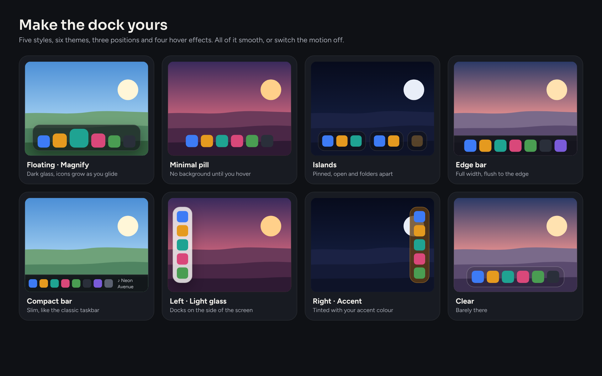
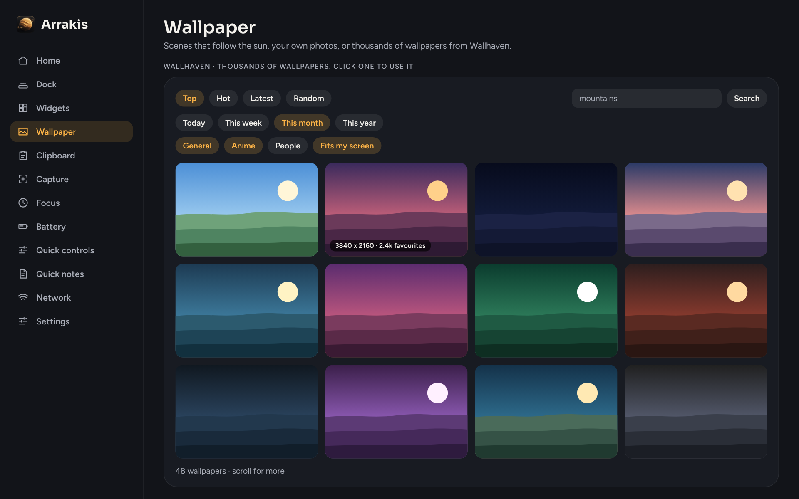
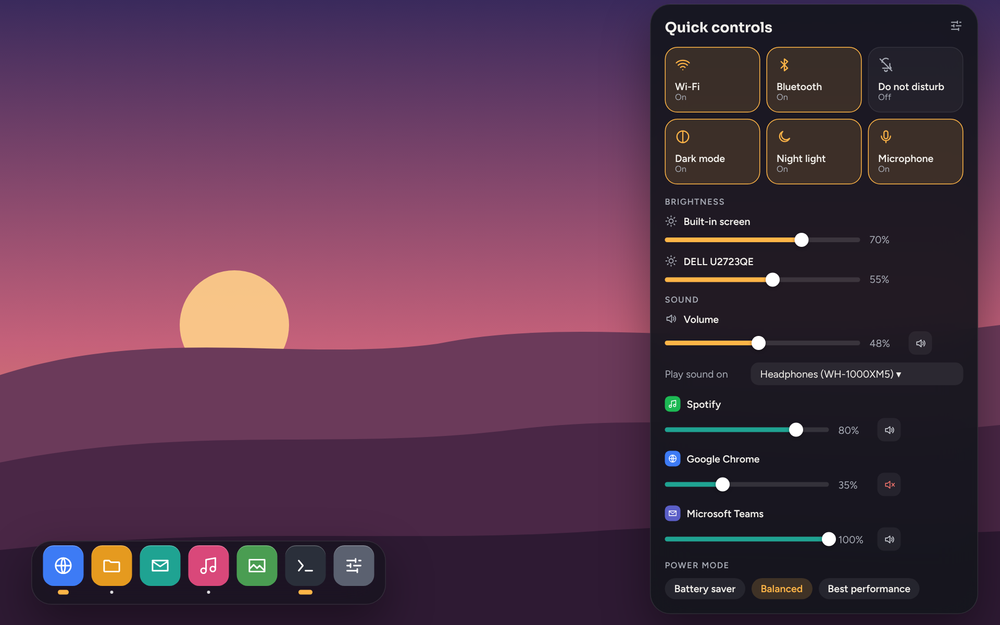
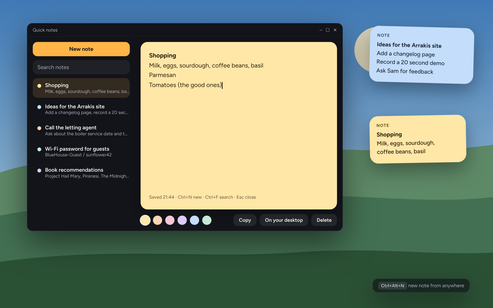
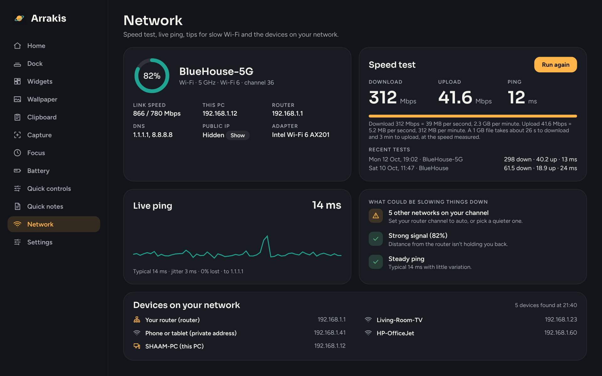

# Arrakis user guide

Everything Arrakis can do, and how to do it. If something isn't covered here,
[open an issue](https://github.com/bhxuk/arrakis/issues) and say what you were trying to do.

- [Getting started](#getting-started)
- [The hub](#the-hub)
- [Command bar](#command-bar)
- [Dock](#dock)
- [Widgets](#widgets)
- [Wallpaper](#wallpaper)
- [Clipboard](#clipboard)
- [Capture](#capture)
- [Focus](#focus)
- [Battery](#battery)
- [Quick controls](#quick-controls)
- [Quick notes](#quick-notes)
- [Network](#network)
- [Updates and moving to a new PC](#updates-and-moving-to-a-new-pc)
- [Shortcuts at a glance](#shortcuts-at-a-glance)
- [Troubleshooting](#troubleshooting)

---

## Getting started

1. Download **[Arrakis-Setup.exe](https://github.com/bhxuk/arrakis/releases/latest/download/Arrakis-Setup.exe)** and double-click it.
2. If Windows shows **"Windows protected your PC"**, click **More info**, then **Run anyway**. This appears because
   the installer isn't code-signed, not because anything is wrong.
3. Leave **Start Arrakis when I sign in** ticked if you want it ready every time you log in.
4. Arrakis opens on the hub. Everything except Wallpaper starts switched on; switch off anything you don't want.

Arrakis lives in the **notification area** by the clock (you may need to click the **^** arrow to see it).

- **Left-click** the icon to open the hub.
- **Right-click** it for quick actions: command bar, quick controls, new note, clipboard, screenshots, focus, edit widgets, speed test, show the Windows taskbar, exit.

Closing the hub window doesn't stop Arrakis; it carries on in the background. To stop it completely,
right-click the icon and choose **Exit Arrakis**.

## The hub

The **Home** page has a card for each module. The switch in the corner turns it on or off straight away.
Click anywhere else on a card to open that module's settings. The **Arrakis itself** card shows how much memory
Arrakis is using and lets you check for updates.

**Settings** (bottom of the sidebar) has:

- **Start with Windows**
- **Appearance**: *Dark*, *Light* or *Match Windows*, and an accent colour (amber, teal, blue, pink, green or purple)
  for buttons, switches and highlights. Click **Restart Arrakis now** to see the change everywhere.
- **Command bar**: on or off, and its shortcut. See [Command bar](#command-bar).
- **Updates**: check for updates, install them automatically, or update now. See [Updates](#updates-and-moving-to-a-new-pc).
- **Backup**: export and import everything.
- **Show the Windows taskbar now**: in case it's hidden and you want it back.
- **Open settings folder**: where your settings, clipboard history and stats live (`%AppData%\Arrakis`).
- **Exit Arrakis**

## Command bar

Press **Alt+Space** anywhere and start typing. Use **Up** and **Down** to move, **Enter** to open, **Esc** to close.

| Type | And you get |
|---|---|
| An app's name | The app, from your Start menu and installed apps |
| A file name | Files from your Desktop, Documents, Downloads, Pictures, Music, Videos and recent files |
| A setting, like *display*, *bluetooth* or *sound* | That page of Windows Settings |
| A sum, like `999 * 1.25` or `(40 + 2) / 3` | The answer. Press Enter to copy it |
| Words you copied earlier | Matching clipboard items. Enter copies it again |
| *screenshot*, *focus*, *clipboard*, *widgets* | Arrakis actions, like **Focus for 50 minutes** or **Screenshot a window** |
| *power* | **Power mode: Battery saver**, **Balanced** or **Best performance** |
| *controls*, *note*, *speed*, *dark*, *mute* | **Quick controls**, **New note**, **Run a speed test**, dark mode, Do not disturb and mute |
| Words from one of your notes | That note. Enter opens it |
| *layout* | Your saved widget layouts |
| Anything else | **Search the web** for it |

If Alt+Space is already used by another app, pick a different shortcut in Arrakis > Settings > Command bar.

## Dock

The dock sits at the bottom of the screen (or the left or right, if you choose) and shows:

- the **Arrakis button** on the left: click it to open the Start menu, right-click it to open the hub;
- your **pinned apps**;
- every **open app**, with a dot underneath;
- **live activities** to the right: what's playing (click to play or pause) and your focus timer (click to pause).

**Using it**

| Do this | And this happens |
|---|---|
| Click an app that isn't open | It opens |
| Click an open app | It comes to the front. Click again to minimise it |
| Click an app with several windows | Each click moves to the next window |
| Rest the mouse on an open app | Live previews of its windows. Click one to switch, or the cross to close it |
| Right-click an app | Pick a window, open a new one, pin or unpin, or close it |
| Drag an app, shortcut or file on to the dock | It's pinned |
| Drag a folder on to the dock | It's added as a folder stack |
| Click a folder stack | Its newest files. Click one to open it, or **Open folder** |

Apps with more than one window open show a small bar with the count under the icon instead of a dot.
**Downloads** is added as a folder stack the first time you run Arrakis. Right-click a stack to open or unpin it.

Right-click any icon > **Dock settings...** to jump straight to them.

**Look (Arrakis > Dock)**

| Setting | Choices |
|---|---|
| Style | *Floating* (rounded, just above the edge), *Minimal pill* (no background until you hover), *Islands* (pinned apps, open apps and folders in separate groups), *Edge bar* (full width, flush to the edge) and *Compact bar* (slim, smaller icons, like the classic taskbar) |
| Position | Bottom, Left or Right |
| Theme | *Match Arrakis* (follows your light or dark setting), *Dark glass*, *Light glass*, *Solid*, *Clear* and *Accent* (tinted with your accent colour) |
| See-through | How much of your wallpaper shows through |
| Icon size | 32 to 72 pixels |
| Dividers | A thin line between pinned apps, open apps and folders |

**Motion**

- **When the mouse is over an icon**: *Magnify* (icons grow and spread apart, like on a Mac), *Zoom* (the icon under the
  mouse grows in place), *Lift* (icons rise a little) or *None*. **How much** sets the size for Magnify and Zoom.
- **Smooth animations**: on, everything eases in and out. Off, everything changes instantly with no movement.
- **Get out of the way**: the dock slides away when a window is maximised or full screen on that screen. Push the mouse
  against that edge of the screen to bring it back.

**Taskbar and screens**

- **Hide the Windows taskbar**: use the dock instead. Arrakis turns on Windows' own *Automatically hide the taskbar*
  setting, so maximised windows use the whole of every screen, then hides the taskbar completely on screens that have a
  dock. On any other screen it stays auto-hidden: push the mouse to that screen's edge and it slides in. Your original
  taskbar setting is put back when Arrakis exits.
- **Put the taskbar back**: brings the Windows taskbar back on every screen straight away (and turns the switch above off).
  The tray menu has the same option, and so does Start > Arrakis > Restore Windows taskbar, which works even if Arrakis isn't running.
- **A dock on every screen**: each monitor gets its own dock, showing the windows that are on that screen. Turn this
  on with **Hide the Windows taskbar** to have no taskbar on any screen.
- **Keep windows clear of the dock**: maximised windows stop at the dock instead of going underneath it (the dock then
  doesn't need to slide away). The dock registers with Windows as an app bar, the same way the taskbar reserves its space.

If Windows keeps bringing the taskbar back (for example while Explorer restarts), Arrakis stops hiding it after a few
tries rather than fight it, tells you, and tries again next time it starts.

**Features**: Live activities, Window previews and Window counts. Underneath are your **Pinned apps** and **Folder stacks**:
remove them, or **Pin a program...** and **Pin a folder...**.

## Widgets

Widgets sit on your desktop, behind your windows. Out of the box you get a clock, weather, calendar,
system rings, now playing and a note.

- **Move**: drag a widget anywhere. It remembers where you put it.
- **Change style**: right-click any widget > Style > *Glass*, *Solid* or *Outline*.
- **Remove**: right-click > Remove this widget, or press **Ctrl+Alt+W** to show red remove buttons on every widget
  (press it again to hide them).
- **Stop accidental moves**: right-click > Lock widgets.
- **Add more**: Arrakis > Widgets, then click a tile.
- **Resize**: right-click > Size > *Small*, *Medium* or *Large*.
- **Line them up**: **Snap to grid** (Arrakis > Widgets) neatens their position when you let go.
- **Each widget's own options**: right-click it. For example *Choose cities...* on world clocks or *Edit symbols...* on stocks.

**Layouts**: set your widgets up the way you like, then in Arrakis > Widgets type a name like *Work* and click
**Save current layout**. Switch between layouts there, or type *layout* in the command bar.

| Widget | Notes |
|---|---|
| Clock | Time and date |
| Weather | Set your city in Arrakis > Widgets first. Uses Open-Meteo (free, no account). Updates every 30 minutes |
| Calendar | This month, today highlighted. The week starts on your Windows setting |
| System rings | CPU, memory, and battery (or disk space on a desktop PC) |
| Battery | Charge and time left |
| Now playing | Works with Spotify, browsers, Media Player and anything else that shows in Windows' media controls |
| Notes | **Double-click** to type. Click away to save |
| Countdown | Right-click > Edit countdown to set the name and date |
| Agenda | Your next events from your calendar (see below) |
| To-do list | Type and press Enter to add. Tick to finish. Right-click > Clear finished items |
| Quick launch | Drag apps, files or folders on to it, or right-click > Add an app or file... |
| World clocks | Right-click > Choose cities... Shows the time difference and whether it's tomorrow there |
| Photo frame | Right-click > Choose folder... It shows your Pictures folder to start with and changes every few minutes |
| Stocks | Right-click > Edit symbols... Prices come from Stooq, so use codes like AAPL.US, VOD.UK or ^UKX |
| Headlines | Right-click > Change feed... and paste any RSS or Atom news feed. Click a headline to read it |
| Ping | Your connection's ping right now and over the last couple of minutes. Green is good, amber is slow, red is offline. See [Network](#network) |

**Connect your calendar**: in Arrakis > Widgets, paste your calendar's **.ics link** under *Calendar link*.

- **Google Calendar**: Settings > click your calendar > *Secret address in iCal format*.
- **Outlook.com**: Settings > Calendar > Shared calendars > *Publish a calendar* > copy the ICS link.
- **iCloud**: share the calendar as a *Public Calendar* and copy the link.

Then the calendar widget marks days with events (hover to see them), the agenda widget lists what's next, and
**Meeting alerts** give you a notification 10 minutes before each event. Focus can use it too.

## Wallpaper

Wallpaper is **off** until you switch it on, so Arrakis never changes your desktop without asking.

Pick a **Mode**:

- **Wallhaven: the one you picked** and **Wallhaven: a popular one each day** (see below).

- **Follow the sun**: dawn, day, sunset and night scenes change with the real sunrise and sunset where you are.
  Arrakis uses the city you set for the weather widget (or Birmingham, UK until you set one).
- **Dawn**, **Day**, **Sunset** or **Night**: keep one scene.
- **Your photos (slideshow)**: choose a folder (subfolders are included) and how often to change.
- **Your photos for each time of day**: choose a photo for each of dawn, day, sunset and night, and they change with the sun.
- **Bing photo of the day**: a new photo each morning.

With the scenes you can also switch on:

- **Match the weather**: clouds, rain, snow, fog and storms appear when they're happening outside.
- **Moving sun**: the sun travels across the sky through the day, and the moon at night.

Every screen gets a picture drawn at its own size, and with your photos each screen gets a different one.
When you switch Wallpaper off (or click **Put my old wallpaper back**), your original wallpaper comes back.

### Wallhaven

Further down the Wallpaper page is a gallery of wallpapers from [wallhaven.cc](https://wallhaven.cc). Scroll and more load as you go.

- **Top**, with **Today**, **This week**, **This month** or **This year**; **Hot**; **Latest**; or **Random**.
- **Search**: type something like *mountains* or *city night* and press Enter.
- **General**, **Anime** and **People** turn those categories on and off. **Fits my screen** only shows wallpapers at
  least as big as your main screen, in the same shape.
- Hover a wallpaper for its size and favourites. **Click it** for a big preview, its colours, and:
  - **Set as wallpaper**: on every screen.
  - **Set on this screen**: with more than one screen, pick one from the list.
  - **Save a copy**: into Pictures\Wallhaven.
  - **Open on Wallhaven**: its page on the website.

Setting one switches the Mode to *Wallhaven: the one you picked*. Pictures you set are kept in the Arrakis settings
folder (the 30 most recent). **Wallhaven: a popular one each day** picks something new from the week's top list every morning.

Only safe-for-work wallpapers are shown. You don't need an account. If you have one, paste your **API key** (wallhaven.cc >
Settings > Account) into the box under the gallery and click **Save key**; it's stored encrypted for your Windows account.

## Clipboard

Arrakis keeps a history of everything you copy: text, links, colours and images.
Windows' own **Win+V** still works; Arrakis keeps a longer, searchable history alongside it.

Press **Ctrl+Alt+V** anywhere to open it. Start typing to search.

| Key | What it does |
|---|---|
| Up / Down | Move through the list |
| Enter | Paste into the app you were using |
| Shift+Enter | Paste as plain text (no fonts or formatting) |
| Ctrl+P | Pin or unpin. Pinned items stay at the top and are never deleted |
| Ctrl+S | Add to the **stack** |
| Ctrl+Shift+V | Paste the whole stack, one item per line |
| Delete | Remove from history |
| Esc | Close |

You can also click an item to paste it, or right-click it for more options (copy only, open link, and so on).

**The stack** is for when you need several things in one go, for example a name, an address and a phone number.
Add each one with Ctrl+S, then paste them all at once.

Right-click an item for **Paste**, **Paste as plain text**, **Paste as**, **Copy only**, **Add to collection**,
**Open link** and **Remove from history**.

**Paste as** changes the text as it goes in: *UPPERCASE*, *lowercase*, *Title Case*, *Sentence case*, *One line*,
*List to commas*, *Commas to list*, *Remove link tracking* (takes `utm_` and similar off links), *Sort lines*
and *Remove duplicate lines*.

**Collections**: right-click > Add to collection > **New collection...** to make one, like *Work* or *Recipes*.
Each collection gets its own filter at the top of the panel.

**Snippets** are bits of text you type often, like your address or a sign-off. Add them in Arrakis > Clipboard >
Snippets, each with a **shortcode**. Type the shortcode in any app (for example `;sig`) and it's replaced with the
snippet. In a snippet, `{date}`, `{time}` and `{clipboard}` are filled in for you. They're also in the panel under
the **Snippets** filter. A few examples are added to start you off.

**Private items**: anything that looks like a card number, bank account (IBAN) or password is shown as dots, kept
out of search and sync, and deleted after a minute (you can change how long). Right-click > **Keep it** if you need it.

**Sync between PCs**: in Arrakis > Clipboard > Sync, choose a folder both PCs can see (OneDrive, Dropbox, Google Drive
or a network drive) and set a password. Do the same on the other PC with the same password. History is encrypted
before it's written to the folder and syncs every 3 minutes. Pinned items, snippets and collections come across too;
private items never do.

**Privacy**: copies that password managers mark as private are never saved. History stays on your PC unless you
turn on sync. Change the size, turn off image saving or clear everything in Arrakis > Clipboard.

## Capture

### Taking a screenshot

| Shortcut | Captures |
|---|---|
| Ctrl+Alt+S | An area you drag, or a window you click |
| Ctrl+Alt+D | A window (hover to see it outlined, click to take it) |
| Ctrl+Alt+A | The whole screen the mouse is on |

The tray menu (right-click the Arrakis icon > **Screenshot**) and Arrakis > Capture also have **All screens**,
**Last area again** and **Area in 5 seconds**, which gives you time to open a menu first.

**Using the Print Screen key**: switch on *Use the Print Screen key* in Arrakis > Capture to use these keys:
**Print Screen** for an area, **Alt+Print Screen** for a window, **Ctrl+Print Screen** for the full screen and
**Shift+Print Screen** for the last area again. Windows may already use Print Screen for Snipping Tool; turn that off in
Windows Settings > Accessibility > Keyboard first.

**While picking an area**

| Do this | And this happens |
|---|---|
| Drag | Capture that area |
| Click | Capture the window under the mouse |
| Space | Switch between area and window mode |
| Arrow keys | Move the mouse one pixel at a time |
| C | Copy the colour under the mouse (for example `#E2585F`) |
| Enter | Capture the whole screen |
| Esc or right-click | Cancel |

The magnifier shows the pixels around the mouse, the exact position and the colour. Switch it off in Arrakis > Capture
if you don't want it. You can also choose to include the mouse pointer in screenshots.

### Editing

**Tools** (top bar). Each has a one-letter shortcut:

| Tool | Key | How to use it |
|---|---|---|
| Select | V | Click something you've added to select it. Drag to move, arrow keys to nudge (Shift for bigger steps), Delete to remove, click a colour to recolour. Double-click text to edit it |
| Box | R | Drag. Shift for a square |
| Ellipse | E | Drag. Shift for a circle |
| Line | L | Drag. Shift snaps to 45° |
| Arrow | A | Drag from where it starts to where it points. Shift snaps to 45° |
| Pen | F | Draw freehand |
| Text | T | Click and type. Enter to finish, Shift+Enter for a new line |
| Callout | S | Click to add a speech bubble and type |
| Steps | N | Click to drop numbered circles: 1, 2, 3... |
| Highlight | H | Drag over something to highlight it |
| Pixelate | P | Drag over anything private |
| Blur | B | Drag over anything private for a soft blur |
| Crop | C | Drag the area you want to keep |
| Colour | I | Click the picture to use that colour (the hex code is copied too) |

**Style** (right side): colour, fill for boxes and ellipses (*None*, *Soft* or *Solid*), line thickness, text size and
a soft shadow on shapes.

**Image**: rotate left or right, flip, resize, greyscale, invert, border (in the current colour), drop shadow and torn edges.
These apply to the picture with everything you've drawn on it, and can be undone.

**Frame**: put the screenshot on a background (*Sunset*, *Ocean*, *Meadow*, *Dusk*, *Light*, *Dark* or none), with padding,
rounded corners and a shadow.

**Text in the picture**: *Blur emails* finds email addresses and pixelates them (this also happens automatically when the
editor opens; switch it off in Arrakis > Capture). *Copy text* reads all the words in the picture and copies them.
Both use Windows' built-in text recognition, so nothing leaves your PC.

**Undo and redo**: Ctrl+Z and Ctrl+Y, or the buttons at the top right. **Zoom**: Ctrl and the mouse wheel, Ctrl+0 to fit,
Ctrl+1 for actual size.

### Sharing it

| Button | Shortcut | Does |
|---|---|---|
| Copy | Ctrl+C | Copies the finished picture |
| Save | Ctrl+S | Saves straight to your screenshot folder using your file name pattern. Click the message at the bottom to show the file |
| Save as... | Ctrl+Shift+S | Choose where, and PNG, JPG, BMP, GIF or TIFF |
| Print | Ctrl+P | Prints it, fitted to the page |
| Paint / Open with... | | Opens it in Paint or any other app |
| Pin | | Floats it above everything. Drag to move, scroll to resize, double-click to close, right-click to copy or edit |

### Capture settings (Arrakis > Capture)

- **After a capture**: open the editor (default), or skip it and copy, save, or copy and save straight away.
- **Folder, file name and format**: the file name can use dates like `{yyyy-MM-dd HH.mm.ss}` and `{title}` for the window's name.
- **Recent**: your latest saved screenshots. Click one to edit it again.
- **Edit an image file...** and **Edit image on clipboard** open any picture in the editor.

## Focus

Press **Ctrl+Alt+F** (or click **Start focus** in Arrakis > Focus).

- A pill appears at the top of the screen with the time left. **Click it** for Pause, +5, Skip and End.
- While you focus: **notifications are silenced**, the **dock hides** and **widgets dim**. Each can be switched off.
- When the time's up you'll hear a chime and a short break starts. After the last session of the round you get a
  longer break.
- **Ctrl+Alt+F** again pauses and resumes.

**Ambient sound**: *Rain*, *Ocean*, *Brown noise* or *White noise*, with a volume slider. They play during focus time
and stop for breaks.

**Settings**: session name, focus length, short and long breaks, and sessions per round.

**What are you working on?** Type a task before you start. It shows on the pill and is saved with the session,
so the report can show where your time went.

**Distracting apps**: list programs like `steam.exe` or `discord.exe` (or click to pick one that's running), then choose
what happens when one opens during focus time: **Nudge** (a reminder) or **Minimise** (straight out of the way).
Breaks are left alone.

**Open on start**: paste a link, like a Spotify playlist, a YouTube lo-fi stream or a document, and it opens each time a session starts.

**Start from your calendar**: once your calendar is connected (Arrakis > Widgets), any event with *Focus* in its
title (or a word you choose) starts a session that runs until the event ends.

**Your week**: this week against last, the last 30 days, your best day, your longest streak, eight weeks of
history, your top tasks and recent sessions.

## Battery

For laptops and tablets. On a desktop PC it says there's no battery, but you can still switch **power modes** there.

- **Health**: how much your battery holds now compared with when it was new.
- **Holds when full**: the actual capacity in watt-hours.
- **Charge cycles**: not every laptop reports this.
- **Charge level, last 7 days**: Arrakis checks every 10 minutes, so this fills in over a few days.
- **Unplug reminder**: a notification when charging reaches your chosen level (80% by default). Keeping a battery
  below 100% most of the time helps it last longer.
- **Health over time**: recorded once a month.
- **Tips for your battery**: after a day or two, Arrakis looks at how you charge and suggests changes, like
  unplugging before bed if it sits at 100% overnight.
- **Low battery alert**: a notification at the level you choose (20% by default) with the apps using the most power right then.
- **Power mode**: *Battery saver*, *Balanced* or *Best performance*, the same as Windows' own power mode setting.
- **Health report**: **Save a report** makes a one-page web page with health, capacity, cycles and a chart, ready to
  print or save as a PDF. Handy when selling a laptop or making a warranty claim.

## Quick controls

Press **Ctrl+Alt+Q** anywhere (or right-click the Arrakis icon > **Quick controls**). The panel opens in the bottom-right
corner and closes when you click away or press **Esc**.

**Switches**: click to turn on or off. Right-click any of them to open that page of Windows Settings.

| Switch | Notes |
|---|---|
| Wi-Fi, Bluetooth | Turns the radio on or off, like the switches in Windows' own quick settings |
| Do not disturb | Stops app notification pop-ups. Focus uses the same switch during sessions |
| Dark mode | Switches Windows and your apps between dark and light |
| Night light | Warmer colours for the evening. If Windows on your PC stores this setting differently, clicking opens the Night light settings instead |
| Microphone | Mutes or unmutes your default microphone for every app |

**Brightness**: a slider for your laptop screen and one for each external monitor that supports DDC/CI (most monitors
from the last ten years; it may need turning on in the monitor's own menu). TVs and some docks don't pass it through.

**Sound**: the master volume and mute button, **Play sound on** to switch between speakers, headphones, a TV and so on,
and a slider and mute button for **each app** that's making sound (music, browser, calls). Arrakis doesn't change any
app's volume unless you move its slider.

**Power mode**: Battery saver, Balanced or Best performance, the same as Windows' own power mode.

In Arrakis > Quick controls you can change the shortcut, and hide the per-app volume or brightness sections.

## Quick notes

Press **Ctrl+Alt+N** in any app. The notes window opens with a fresh note ready to type into. Everything saves as you type.

- **Find a note**: type in **Search notes** (or press **Ctrl+F**). You can also type part of a note in the command bar.
- **New note**: the **New note** button, or **Ctrl+N** in the notes window.
- **Colour**: pick one of the six dots under the note.
- **Pin to desktop**: puts the note on your desktop as a sticky. **Double-click** the sticky to edit it there; changes
  go straight back into the note. Right-click the sticky > **Open in Quick notes** to open it in the window.
- **Copy** puts the whole note on the clipboard. **Delete** removes it (and its sticky).
- **Esc** closes the window. Empty notes are tidied away when you close it.

**Notes as text files**: every note is also saved as a `.txt` file, named after its first line, in **Documents\Arrakis Notes**.
It's kept up to date as you type, and renamed if you change the first line. In Arrakis > Quick notes you can:

- **Change folder...** to save them anywhere, such as a OneDrive or Dropbox folder.
- Click the **folder button** to open the folder (there's one in the notes window too).
- **Use the default** to go back to Documents\Arrakis Notes.
- Turn **Save notes as text files** off if you'd rather they only live inside Arrakis.

Text files (`.txt` or `.md`) you put in the folder show up as notes the next time you open Quick notes, keeping their
file names. If you edit a note's file in another app, the change comes back into Arrakis. Deleting a note sends its file
to the Recycle Bin.

Notes are also kept in `notes.json` in the Arrakis settings folder and included when you export a backup.

## Network

**Your connection**: the Wi-Fi network you're on, signal strength, band (2.4 or 5 GHz), Wi-Fi standard and channel,
link speed to the router, this PC's address, the router's address and DNS. Click **Show** next to Public IP to look it up.
On a cable it shows the link speed instead.

**Speed test**: click **Run speed test**. It measures ping and jitter, then download and upload, using Cloudflare's
public speed test servers. Underneath, it says what the result means for files: 8 megabits make a megabyte, so
312 Mbps is about 39 MB per second, or 2.3 GB per minute, and a 1 GB file takes about 26 seconds. It takes about 20 seconds and can use a few hundred MB on a fast connection, so be careful
on a mobile hotspot. Your last results are listed underneath, with the network you were on. You can also start one
from the command bar or the tray menu.

**Live ping**: Arrakis pings 1.1.1.1 every 3 seconds while the Network module is on and draws the last few minutes.
Red dots are pings that got no reply. Underneath you'll see typical ping, jitter (how much it jumps around) and how
many were lost. Add the **Ping widget** in Arrakis > Widgets to keep an eye on it from the desktop.

**What could be slowing things down**: checks your signal, whether you're on 2.4 GHz when 5 GHz is available, how many
other networks share your channel, your link speed, whether a cable is stuck at 100 Mbps, and your ping, jitter and
packet loss, then says what to try.

**Devices on your network**: click **Scan my network**. Arrakis tries every address on your home network and lists
what answers, with its name where it has one. Phones often use a *private address* that changes, so they show as
"Phone or tablet". Devices that are asleep may not show up.

**Drop alerts**: with **Tell me when the internet drops** on, you get a notification when the connection stops answering
for about 10 seconds, and another when it's back saying how long it was out.

**Ping** in settings changes the address used for the live ping and drop alerts. Use your router's address (shown at
the top) to test just your Wi-Fi, or keep 1.1.1.1 to test the whole connection.

## Updates and moving to a new PC

**Updates**: Arrakis checks GitHub for a newer version when it starts. With **Install updates automatically** on
(the default), it downloads and installs it quietly, then reopens. It never does this during a focus session.
It checks again every 6 hours, so a PC that stays on for days still gets updates.

With automatic updates off, you'll get a notification instead: **click it** to install. You can also right-click
the tray icon > **Install update**, or click **Check for updates** on the Home page or **Check now** in
Arrakis > Settings, then **Install**. Every one of these downloads and installs the update for you; there's
nothing to download yourself.

**Moving to a new PC**: in Arrakis > Settings > Backup, click **Export...** to save one file with your settings,
widgets and layouts, clipboard history, snippets, focus history and battery history. Install Arrakis on the other
PC and click **Import...**. Arrakis restarts with everything in place.

## Shortcuts at a glance

| Shortcut | Does |
|---|---|
| Alt+Space | Open the command bar |
| Ctrl+Alt+Q | Open quick controls |
| Ctrl+Alt+N | New note |
| Ctrl+Alt+V | Open the clipboard |
| Ctrl+Alt+S | Screenshot of an area |
| Ctrl+Alt+D | Screenshot of a window |
| Ctrl+Alt+A | Screenshot of the full screen |
| Ctrl+Alt+F | Start, pause or resume focus |
| Ctrl+Alt+W | Show or hide widget remove buttons |

You can change the command bar, clipboard, screenshot, quick controls and notes shortcuts in their settings pages. If a shortcut doesn't work,
another app is probably using it; Arrakis will tell you and you can pick a different one.

## Troubleshooting

**The taskbar has gone and I want it back.**
Open Start > Arrakis > **Restore Windows taskbar**. Or right-click the Arrakis icon > **Show Windows taskbar**.

**Windows says "Windows protected your PC".**
Click **More info** > **Run anyway**. It appears for apps that aren't code-signed.

**A shortcut does nothing.**
Another app may already be using it. Go to that module's page in Arrakis and choose a different one.

**My calendar isn't showing.**
Check the link ends in `.ics` and is the *secret* or *published* address, not the normal web page. Then right-click
the agenda widget > **Refresh calendar**.

**Snippets don't expand in one app.**
Some apps running as administrator don't accept typing from other apps. Run Arrakis the same way, or paste the
snippet from the clipboard panel instead.

**Clipboard sync isn't picking things up.**
Both PCs need the same folder and the same password. The sync status under Arrakis > Clipboard > Sync says when it last ran.

**The weather says "Set your city".**
Arrakis > Widgets > Weather city. Type a town and click **Set city**.

**A brightness slider is missing for my monitor.**
The monitor needs DDC/CI, which is sometimes switched off in the monitor's own on-screen menu. Some docks and TVs don't pass it through.

**The speed test is slower than my broadband package.**
Try it on a cable, or near the router. Wi-Fi, other devices downloading, and VPNs all cut the result. The tips on the Network page usually say which.

**Something else.**
Open Arrakis > Settings > **Open settings folder** and find `arrakis.log`. Attach it to an
[issue](https://github.com/bhxuk/arrakis/issues) along with what happened.
